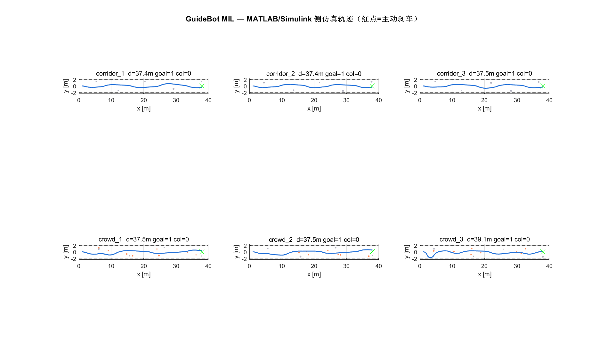
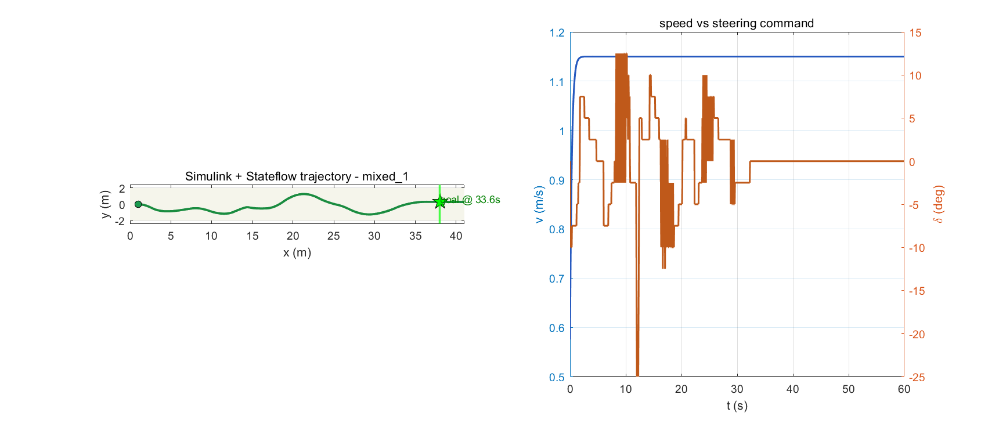
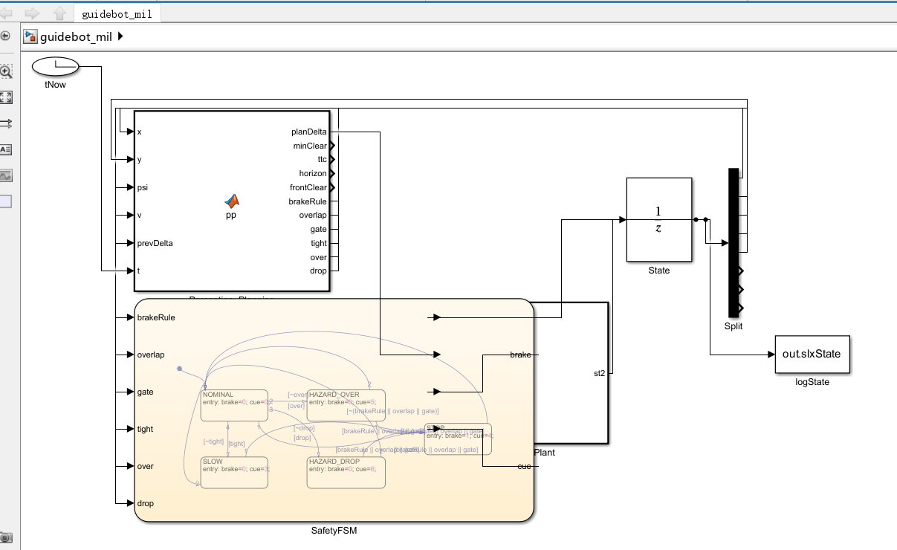

# GuideBot · 复刻 Glide 的行人导引机器人软件栈

[](python/)
[](matlab/)
[](LICENSE)

把商用智能导盲杖 **Glide** 的技术栈，用**零硬件成本**复刻成一个**可运行、可测量、可 Ablation** 的软件系统。

> **关于范围**：本项目**不含任何真实硬件**，全部为仿真层面的算法实现与评测。
> 难点在系统设计与实验验证，不在结构件——这也是它作为一个软件项目值得看的地方。

**30 秒看懂它的价值**：不是"检测到障碍就停"的 Demo，而是一条完整闭环 ——
感知<｜hy_place▁holder▁no▁813｜>规划 → 决策 → 物理执行 → 用户反馈 → 再感知，
并且每个性能结论都配了对照实验（包括那些结论不好看的实验）。


*MATLAB MIL 仿真：6 类场景的轨迹，红点 = 主动刹停。*

---

## 目录

```
guidebot/
├── python/                 # Python 侧（零第三方依赖，Python 3.9+ 直接跑）
│   ├── guidebot/           # 核心库：world / sensors / planner / controller / sim / benchmark
│   ├── run_benchmark.py    # 全量评测（~2 分钟）→ results/RESULTS.md
│   ├── run_demo.py         # 终端实时演示
│   └── export_matlab.py    # 导出场景/参数/逐帧决策日志 → matlab/data/
│
├── matlab/                 # MATLAB 侧（可选，需 MATLAB R2020a+）
│   ├── gb_*.m              # 控制律的 MATLAB 实现（与 Python 逐帧等价）
│   ├── run_mil*.m          # MIL：闭环独立复现 + 消融套件
│   ├── verify_against_python.m  # SIL：逐帧 bit-level 交叉验证
│   ├── build_guidebot_model.m   # 脚本自动生成 Simulink 模型 + Stateflow
│   ├── run_live_demo.m     # 一键实跑：core / simulink 两个阶段
│   ├── guidebot_mil.slx    # 自动生成的模型
│   └── generated_c/        # MATLAB Coder 生成的 ANSI C（无动态内存）
│
├── results/                # 评测结果与截图（README 引用的图都在这里）
└── docs/INTERVIEW_NOTES.md # 简历写法与面试问答备忘
```

---

## 快速开始

```bash
cd python
python run_benchmark.py            # 全量评测 ~2 分钟 → ../results/RESULTS.md
python run_benchmark.py --quick    # 冒烟模式 ~25 秒
python run_demo.py --scene overhead          # 终端实时演示
python run_demo.py --scene mixed --no-brake  # 关掉制动距离不等式，看它怎么撞上去
```

`results/replay.html` 是**单文件可视化回放**（原生 Canvas，双击即可打开）：能看到设备眼前的情况、绿色的规划轨迹、红色的刹车动作，以及当前下发的提示词。

**MATLAB / Simulink 链路**（可选）：

```bash
python export_matlab.py            # 导出 cross-verification 所需数据到 ../matlab/data/
```

```matlab
addpath('matlab')
verify_against_python              % ① SIL：Python 与 MATLAB 的控制律逐帧比对
run_mil_suite                      % ② MIL：8 变体 × 15 场景，与 Python 侧互证
codegen_controller                 % ③ 安全层 → ANSI C
run_live_demo('simulink')          % ④ 自动生成模型并仿真（~1 分钟）
```

无 GUI 批量执行：`matlab -batch "addpath('matlab'); run_live_demo('core')"`

---

## 1. 它和普通课程设计的区别

| 维度 | 普通课程设计 | GuideBot |
|---|---|---|
| 形态 | 离线跑模型，输出一个 accuracy | 感知→规划→控制→人机反馈的**实时闭环** |
| 时延 | 不考虑 | 端到端延迟显式建模（含 `v·T_latency` 补偿项） |
| 安全 | 无 | 分层 fail-safe + 可推导的制动距离不等式 |
| 评测 | 一个数字 | 5 类场景 × 多种子 × 9 组消融 + 延迟敏感性实验 |
| 可信度 | Demo 视频 | 三种实现（Python / MATLAB / Simulink）互证，失败结论也如实写出 |

---

## 2. 系统架构

```
        ┌──────────────── 感知层 sensors.py ────────────────┐
        │ 双层射线：h_low=0.95m（相机层）/ h_high=1.5m（悬空层）│
        │ 近距下视探头：前向 1.3m 内的负障碍（坑 / 下行台阶）   │
        │ 噪声 + 丢帧；perceived_obstacles() 做信息隔离        │
        └──────────────────────┬───────────────────────────┘
                               ▼
        ┌──────────────── 规划层 planner.py ────────────────┐
        │ 一维"转向空间"DWA：候选转角 → 预测轨迹 →           │
        │ 评分（碰撞屏障 / 净空 / 端点到瞄准点 / 平滑 / 贴墙） │
        └──────────────────────┬───────────────────────────┘
                               ▼
        ┌──────────────── 控制层 controller.py ─────────────┐
        │ ① 制动距离不等式  ② 低速可控性门限  ③ 转向速率限制   │
        │ 输出：转角 + 刹停 + 触觉/语音词表                   │
        └──────────────────────┬───────────────────────────┘
                               ▼
        ┌──────────────── 人机闭环 sim.py ──────────────────┐
        │ 人提供前向速度 v（外生输入，不可被命令）             │
        │ 听到提示 → reaction_s 延迟后才改变步速               │
        └──────────────────────────────────────────────────┘
```

**最关键的一条设计**：`ψ̇ = v·tan(δ)/L`，其中 **v 由人提供**。
这和普通轮式机器人完全不同——你不能命令设备"慢一点"，只能转向和刹车。
后面所有技术点都从这一个约束推导出来。

---

## 3. 三个核心技术点

### ① 制动距离不等式（RSS / 安全走廊的行人化版本）

行进方向必须始终保有

```
d_free ≥ v²/(2·μ·g) + v·T_latency + margin
```

一旦规划器给出的**最优**轨迹正前方自由距离不足，就不许继续 → 立刻刹停。
压力实验（延迟 300ms / 丢帧 6%）里关掉它，完成率从 66.7% 升到 100%，
代价是碰撞率 **1.94 → 3.38 次/km**，还多出 3.4 次/km 的踩空。

### ② 低速可控性门限（Controllability Gate）

由 `ψ̇ = v·tan(δ)/L` 推出：横移能力 ≈ `(v·T)²·tan(δ_max)/(2L)`，**正比于 v²**。
所以当用户站住不动时，转向权限趋于零——再好的规划器也转不动它。
正确的处理不是硬撑，而是**诚实**：刹停并提示用户重新站位。

### ③ 信息隔离：规划器只能看到 sensors 让它看到的东西

`sensors.perceived_obstacles()` 严格按"视野角 + 作用距离 + 层高度"筛障碍。
没有这一层，所有消融实验都是假的——第 6 节里记了这个具体的经历。

---

## 4. 评测结果

5 类场景 × 3 个随机种子 = 15 回合，全部"保证可解，但必须用对能力才能解"。
完整表格见 `results/RESULTS.md`。

### 4.1 常规条件（延迟 100ms / 丢帧 1%）

| 变体 | 完成率 | 碰撞/km | 悬空撞击/km | 踩空/km | STOP/km |
|---|---|---|---|---|---|
| **full（完整栈）** | **86.7%** | **0.00** | **0.00** | **0.00** | 72.8 |
| no_brake_rule | 100% | 0.00 | 0.00 | 0.00 | 0 |
| no_gate | 86.7% | 0.00 | 0.00 | 0.00 | 72.8 |
| no_high_layer | 86.7% | **18.35** | **18.35** | 0.00 | 60.6 |
| no_probe | 100% | 0.00 | 0.00 | **13.94** | 0 |
| no_prediction | 93.3% | 0.00 | 0.00 | 0.00 | 50.3 |

- **完整栈 15 回合零事故**，代价是 13% 的回合会走进"必须停下等行人过去"的僵局。
- **去掉悬空层 → 18.4 次/km 悬空撞击**：直接验证了"传统盲杖探不到 Head-height 危险"这个产品论断。
- **去掉下视探头 → 13.9 次/km 踩空**：证明近距负障碍需要独立感知通道。
- **no_gate 与 full 完全一致**：这本身也是结论——在当前参数下该门限几乎不触发。没有凹数据。
- **no_brake_rule 在常规条件下仍是 0 碰撞**，说明这张表不足以证明安全层的价值——这正是下面压力实验组存在的原因。

### 4.2 压力条件（延迟 300ms / 丢帧 6%）

| 变体 | 完成率 | 碰撞/km | 踩空/km | STOP/km |
|---|---|---|---|---|
| **stress / full** | 66.7% | **1.94** | 0.00 | 129.8 |
| stress / no_safety | 100% | **3.38** | 3.38 | 0 |
| stress / no_prediction | 73.3% | **5.56** | 0.00 | 102.0 |

**这一组才是关键实验**：感知良好、延迟很低时，单靠规划器就能躲开多数障碍，
`no_safety` 也能拿到 0 碰撞——那张表其实是**无效实验**。
只有在感知退化和高延迟下，安全监督层与运动预测的价值才显现：

- 安全监督层把碰撞率从 3.38 降到 **1.94 次/km**（代价是完成率 100% → 66.7%）；
- 运动预测把碰撞率从 5.56 降到 **1.94 次/km（−65%）**。

### 4.3 延迟敏感性（mixed 场景）

| 端到端延迟 | 20ms | 100ms | 200ms | 350ms |
|---|---|---|---|---|
| 碰撞/km | 0 | 0 | 0 | **10.03** |
| 险情(near-miss)/km | 8.5 | 10.6 | 14.3 | 40.1 |

控制律里 `v·T_latency` 的显式补偿一直顶到 200ms 都有效，**350ms 是系统能容忍的上限**。

---

## 5. MATLAB / Simulink：三层验证（SIL → MIL → 代码生成）

Python 负责"把算法想清楚"，MATLAB 负责"证明它能被工程化"。
这两件事回答的是**两个不同的可信度问题**：

| 层级 | 回答的问题 | 判定标准 | 实测结果 |
|---|---|---|---|
| **SIL 交叉验证**<br>`verify_against_python` | 同一套控制律在两种语言下真的是同一套吗？ | 逐帧 **bit-level** 一致 | **2617 帧：转向角偏差 0，brake/cue/reason 零帧不一致** |
| **MIL 模型在环**<br>`run_mil_suite` | 换一个独立实现，结论还成立吗？ | 统计结论同向、量级一致 | 8 变体 × 15 场景，与 Python 侧同向 |
| **代码生成**<br>`codegen_controller` | 它能不能真的进 MCU？ | 生成无动态内存的 ANSI C | `generated_c/gb_supervise_entry.c` |
| **Simulink 仿真**<br>`run_live_demo('simulink')` | 同一个模型跑出来行为对吗？ | 行为与 Python/MIL 一致 | mixed_1：**33.6 s 抵达终点** |

为什么值得做这件事：跑一次就写结论，换台机器可能复现不出来。
"两个独立实现给出同向结论"至少说明**结论不是某个随机数序列的巧合**。

### 5.1 Python 与 MATLAB 消融对照

| 变体 | Python 碰撞/km | MATLAB 碰撞/km | Python 踩空/km | MATLAB 踩空/km | 结论 |
|---|---|---|---|---|---|
| full | 0.00 | 0.00 | 0.00 | 0.00 | 两侧都零事故 ✓ |
| 去掉悬空感知层 | 18.4 | **14.7** | — | — | 两侧都测出悬空撞击 ✓ |
| 去掉下视探头 | — | — | 13.9 | **14.3** | 几乎相同 ✓ |
| 去掉安全约束 | 完成率 100% + 碰撞 | 完成率 100% + 碰撞 | — | 1.7 | 都复现"牺牲安全换通过率" ✓ |
| 压力 + 去掉运动预测 | 5.56 | **5.30** | — | — | 高度一致 ✓ |

完整数据见 `results/MIL_RESULTS.md`。

### 5.2 架构分层：只有下半部分掌握刹车

```
┌──────────── AI 主机（Linux, 20Hz, extrinsic, 可变尺寸）────────────┐
│  双层射线 → 感知信息隔离 → 转向空间 DWA → planDelta / minClear / ttc │
└──────────────────────────┬────────────────────────────────────────┘
                           │
┌──────────── 安全 MCU（100Hz, 可代码生成, 全标量）──────────────────┐
│  gb_safety_compute（制动不等式 / 可控性门限）→ Stateflow 安全状态机   │
│  → 转向速率限幅 → brake / cue / delta                              │
└──────────────────────────┬────────────────────────────────────────┘
                           │
┌──────────── Plant：人 + 无动力轮运动学 ───────────────────────────┐
│  ψ̇ = v·tan(δ)/L     ← v 由人给（不可命令），δ 由机器给              │
└──────────────────────────────────────────────────────────────────┘
```

这条分层线不是画着好看的：**AI 主机死机、掉帧、返回垃圾值时，设备只退化成一根会刹车的普通手杖**，
而不是把人推向危险。Simulink 里把 AI 侧声明为 `coder.extrinsic` 正是因为这个——
它需要动态内存和随机数，本来就不该进代码生成；真正必须可验证的只有下面那一层。

### 5.3 Simulink 模型


*Simulink + Stateflow 仿真（mixed_1）：轨迹图 + 速度/转向指令曲线。*

模型由 **`matlab/build_guidebot_model.m` 脚本自动生成**，不是手画的：

1. 模型成为**可版本管理的产物**：改算法 → 重新生成 → 回归测试；
2. 参数从 `params.json` 注入，不存在"模型里手抄的常数和代码不一致"——这种漂移在
   "生成 C 烧进 MCU"的场景下最难排查（Simulink 里跑得好好的，烧进去行为就变了）；
3. 任何人可以一行命令复现整个模型，而不是面对一个黑盒 `.slx`。

| 块 | 类型 | 职责 |
|---|---|---|
| `tNow` | Clock | 绝对时间（动态世界必须按绝对时间参数化） |
| `State` | Unit Delay | 8 维状态递推 `[x, y, ψ, v, δ, vTarget, backoff, hold]` |
| `Split` | Demux | 拆出标量给下游 |
| `Perception_Planning` | MATLAB Function | 双层射线 → 感知隔离 → 转向空间 DWA → 安全判据 |
| `SafetyFSM` | Stateflow Chart | 五态安全状态机 → `brake` / `cue` |
| `Actuator_Plant` | MATLAB Function | 转向速率限幅 + 人/无动力轮运动学 |
| `logState` | To Workspace | 记录轨迹 |

静态结构验证（`results/simulink_model_report.md`）：**悬空输入端口 0 个**、
Stateflow **5 态 / 12 条转移**、反馈闭环成立。

模型是**自包含**的：参数注入抽成 `gb_setup_base.m` 并挂到模型的 `InitFcn` 回调，
打开 `.slx` 直接点运行即可，不需要先跑任何脚本。

### 5.4 Stateflow 安全状态机

`NOMINAL / SLOW / HAZARD_OVER / HAZARD_DROP / STOP` 五态，
进入 `STOP` 的条件：`brakeRule || overlap || gate`。
用状态机而非 if-else 链的意义：它可以被 **Simulink Design Verifier 做形式化验证**、
被 **Coverage 做覆盖度分析**——这是安全关键系统（ISO 26262 / IEC 61508）的标准做法。


*自动生成的模型顶层结构与 Stateflow 五态状态机。*

---

## 6. 开发过程中真实踩过的坑

这些都是**跑出来才发现的**，不是事后诸葛。它们也是这个项目最有信息量的部分。

1. **机器人原地画圈 90 秒走了 100 米却没出门**：初版用 42° 转向 + 0.22m 轴距，偏航角速度高达 4.7 rad/s，采样器发现"转满一圈"能让 `wrap(ψ)` 回到 0，于是把它当成最优解。修法：真实转向几何（25° + 0.45m），并把目标代价从航向差改成"轨迹端点到瞄准点的距离"。

2. **人被叫停一次就永远不动了**：每帧重复下发同一个提示，会把延迟触发时刻不断往后推，形成**永久饥饿**。修法：`Human.schedule()` 加"目标未变则不再重排"的早退。

3. **Ablation 全是假的**：规划器直接用 world 的真值障碍表（上帝视角），导致关掉悬空层射线后机器人依然完美避开看不见的横杆。修法：引入 `perceived_obstacles()` 做严格信息隔离——之后才第一次测出悬空撞击。

4. **规划器宁可撞上去也不绕**：净空代价一开始写成线性 `max(0, target_clear − clear)`，于是"穿过坑洞"只罚约 1.5 分，"提前绕开"因为端点和航向偏移要付约 3.7 分——规划器做出了两害相权取其轻的正确计算，却选了撞上去那条路，然后安全层立刻刹车、人停下、转向权限归零 → **永久死锁**。修法：**"会不会撞"是二元约束，代价必须是屏障函数**，不能拿去跟舒适性做线性 trade-off。修完完成率 40% → 87%。

5. **世界其实是静止的**：所有真值判定都用 `center_at(0.0)`，行人从没动过——"运动预测"这条消融整整几轮都是**空转**。修法：全链路改成绝对时间 `t` 参数化。这条消融立刻有了意义：压力下碰撞率 5.56 → 1.94。

6. **静止时规划视野坍缩**：前瞻按 `horizon = preview_dist / v_pred` 算，人一停 v→0，预测轨迹只剩 1 米——站在坑洞前一米时，1 米的视野根本规划不出绕行路线。修法：`v_floor` 取接近正常步速，语义是"假设用户会按正常节奏继续走"。

7. **转得太灵活反而看不见路**：25° 转向 + 0.45m 轴距 = 转弯半径 0.97m，而预测里程是 3.2m——轨迹绕了半个圈又转回障碍旁边。修法：让转向几何与前瞻距离匹配。

8. **刹车判据太激进会把系统锁死**：只要预测轨迹在未来 3 米内任一点擦到 15cm 就刹停，"1.5 秒后才擦到的东西"也要立刻停下。修法：改用 **TTC 门限**，远的冲突交给转向解决。

脚本化建模（Stateflow API）又贡献了四个坑，每一个都只在"编译/仿真"时才爆出来：

9. **两个状态矩形"相切"就等于交叉**：NOMINAL 的底边坐标正好等于 SLOW 的顶边，Stateflow 编译期报"状态不能与另一个状态或结点交叉"，还附赠一个完全不相关的端口维度错误——级联报错极具误导性。修法：状态之间留出空白间隙。

10. **顶层互斥状态必须有默认转移**：不设默认转移，初始状态未定义，编译期直接失败。修法：创建一条 Source 为空的转移指向初始状态。

11. **MATLAB Action Language 里 `!` 是非法的**：一条转移写成 C 风格的 `[!(a||b)]`，报"解析失败"且只给转移标签、不指出错在哪一格。修法：全图统一 `~`。

12. **枚举语义在两个实现里分叉了**：Simulink 侧人模型用区间判断 `cue>3.5 → 停`，把"提示前方有悬空障碍(cue=5)"也吃成了"罚站立定"——逐帧 trace 显示位置冻结在 5.31m、速度单调衰减到 0，而 Python/MIL 侧用精确枚举 `cue==4` 所以能跑完。修法：**枚举量跨实现必须用同一套判断**。这条尤其典型：每一侧单独看都没问题，合起来行为分叉。

诊断工具也留在仓库里了：`matlab/diag_slx_trace.m` 会把模型内部信号逐帧打到日志——
**"模型能编译"不等于"模型行为正确"**，这个脚本就是用来证明后者的。

---

## 7. 已知局限

- 纯 2D 仿真，**没有做 sim-to-real**：没有真实相机噪声标定、没有轮胎滑移、没有 IMU 漂移。
- 感知是理想化的扇形射线，没有接入真实深度模型（`sensors.Observation` 就是为替换成 Depth Anything V2 的推理而留的接口）。
- 遮挡未建模；行人是恒定速度模型，没有社会性意图推理。
- 触觉反馈只在控制律里表达了语义，**没有做真人用户实验**——仿真数据不能冒充实测。
- 代码生成到 ANSI C 已完成（无动态内存），但**没有在目标 MCU 上编译执行**（本机无 C 编译器）。

---

## 8. 路线图

| 优先级 | 任务 | 意义 |
|---|---|---|
| P0 | 把 `sensors` 换成 Depth Anything V2 (ONNX) 的真实深度估计 | 深度学习落地，并能对比"理想感知 vs 真实感知"的性能衰减 |
| P0 | 录制真实走廊视频做离线回放评测 | 私有 benchmark |
| P1 | 加 Teach-and-Repeat（NetVLAD + FAISS）实现"带它走一遍就认路" | 对标 Glide 的路线记忆能力 |
| P1 | 用 Conflict-based / ORCA 替换启发式评分 | 有论文可引，有理论保证 |
| P2 | 小样本蒙眼用户实验 + NASA-TLX 量表 | HCI 实验素养 |

---

## 附录 · 环境要求

- **Python**：3.9+，**零第三方依赖**（只用标准库）。任何系统 clone 后即可运行全部评测。
- **MATLAB**（可选链路）：R2020a+，需 Simulink、Stateflow、MATLAB Coder。已验证版本 R2024a。
- 运行时：全量评测约 2 分钟；MATLAB `run_live_demo('core')` 约 1 分钟。

**许可证**：MIT，见 [LICENSE](LICENSE)。
